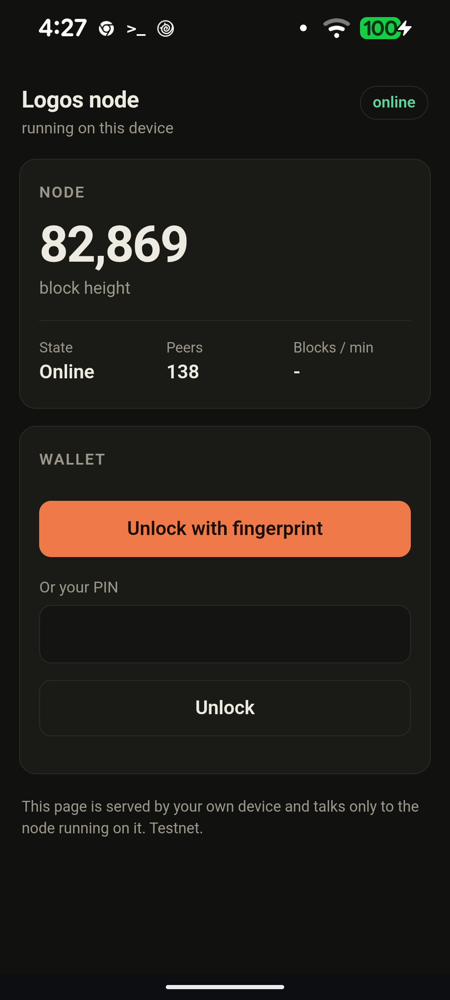

# Logos node on an Android phone

The official [Logos blockchain node](https://github.com/logos-blockchain/logos-blockchain), unmodified, running and fully synced on an Android phone (after starting from a copy of a synced node's database, [see below](#what-works-today)). It comes with a local web app that shows the node's status and is a wallet (PIN and fingerprint unlock, receive and send), and that you can add to the home screen.

Nothing is cross-compiled: what runs on the phone is the unmodified `linux-aarch64` release binary of `logos-blockchain-node` 0.3.4, inside Android's built-in Linux Terminal. A *node* is the program that keeps a copy of the blockchain, checks every new *block* (a batch of transactions) and passes them on to other nodes.

<p>
<br>

</p>

Unofficial community work. Testnet only (the *testnet* is the public test network; its coins have no value).

[](https://github.com/jefdiesel/logos-node-android/actions/workflows/install-test.yml)

## What works today

On the test phone (Pixel 8, 8 GB RAM, Android 17, Linux Terminal):

- The node is fully synced and **Online**, following the tip of the chain: block 82,869 in the screenshot above, the same height as a desktop reference node, with 130+ peers (other nodes it is connected to).
- It received a real transfer: 100,000 Logos sent from another node's wallet arrived in the phone node's wallet, and the phone's node reported the new balance. The sender paid a fee of 2,298.

**The catch: it got there by starting from a copy of an already-synced node's database, not by syncing from the first block.** Syncing from the first block ran out of memory on the phone (see [Why not sync from the first block](#why-not-sync-from-the-first-block)). This repo does not publish such a copy; [Starting from a synced node's database](docs/start-from-a-synced-database.md) describes the method, and what you have to trust to use it.

## Status

| | |
|---|---|
| Node runs, makes its own keys, joins the testnet | works on the test phone |
| Synced and Online, following the chain tip | works on the test phone, after a start from a synced node's database |
| Receives a real transfer | works on the test phone |
| Web app: status, PIN wallet, fingerprint unlock, home-screen icon | works on the test phone |
| Full sync from the first block on a phone | **not done**: Android stopped the Linux box each time, see [below](#why-not-sync-from-the-first-block) |
| `install.sh` | passes in CI on a clean arm64 Linux machine. **Not yet run on a freshly reset phone** |
| `install-termux.sh` | passes in CI inside the Termux Docker image. **Never run on a real phone** |
| One-tap Android app | no. Setup is by hand, in a terminal |
| Native Android build of the node | in progress on the `native` branch, no working build yet (see [Native build](#native-build-work-in-progress)) |

## Which phones have the Linux Terminal

To check your own phone: Settings → System → Developer options → **Linux development environment**. If that switch isn't there, use Termux.

There is no official list. This one is collected from press reports, as of November 2026, and it depends on the phone's chip:

| Chip | Phones reported working | Notes |
|---|---|---|
| Google Tensor (G1 and later) | Pixel 6 and later, Pixel Fold, Pixel Tablet | Where the feature started. **Pixel 8 tested here.** |
| Samsung Exynos 2500 / 2600 | Galaxy Z Flip 7; Galaxy S26 and S26+ (Exynos models, One UI 8.5) | Only the Exynos versions |
| MediaTek Dimensity 9400+ and later | Xiaomi 15T Pro | Other phones with these chips may work |
| Qualcomm Snapdragon | REDMAGIC 12 Pro (first one reported, November 2026) | Most Snapdragon phones don't: see below |

Reported **not** working: Galaxy S26 Ultra, Galaxy Z Fold 7, Xiaomi 17 Pro and other Snapdragon 8 Elite phones (the Terminal fails with "non-protected VMs are not supported on this device"), and older Galaxy phones such as the S23 Ultra.

You also need about 8 GB of RAM, a charger, Wi-Fi and a few GB of free storage.

Sources: [9to5Google on the first Snapdragon phone](https://9to5google.com/2026/11/04/the-first-snapdragon-phone-with-android-linux-terminal-support-is-here/), Android Authority on [Snapdragon chips](https://www.androidauthority.com/snapdragon-chips-android-linux-terminal-3608648), the [Galaxy Z Flip 7](https://www.androidauthority.com/galaxy-z-flip-7-linux-terminal-3578675), the [Galaxy S26](https://www.androidauthority.com/galaxy-s26-linux-terminal-3645822) and [One UI 8.5](https://www.androidauthority.com/samsung-phones-linux-terminal-one-ui-8-5-3652503).

## Install (Linux Terminal)

The Linux Terminal app runs a small Debian Linux system in a virtual machine (VM) on the phone, called "the Linux box" below.

1. Settings → System → Developer options → **Linux development environment** → on. Open the **Terminal** app and let it install. It asks for the microphone permission; the node doesn't need it.
2. Phone settings that turned out to matter on the test phone:
   - Developer options → **Disable child process restrictions** → on. Without it, Android killed the Terminal's Linux box for "excessive cpu" a few minutes after another app was put in front of it.
   - Terminal → gear → Advanced → **Keep awake** (it offers up to 1 day).
   - Terminal → gear → Advanced → **Memory size**: about **2500 MB** on an 8 GB phone. That left the phone about 1 GB free. At 4000 MB it had about 450 MB free, and Android killed the Linux box when another app opened.
3. In the Terminal, run:

   ```sh
   curl -fsSLO https://raw.githubusercontent.com/jefdiesel/logos-node-android/main/install.sh && sh install.sh
   ```

4. Ports: the Terminal app asks whether to open each TCP port of 1024 or above that something in the Linux box listens on. **Allow 8090** (the web app). **Deny 8080** (the node's own API, which should stay inside the Linux box) and anything else. You can change these later under Terminal → gear → Port control.
5. Open **`http://localhost:8090`** in the phone's browser. Use `localhost`, not `127.0.0.1`: fingerprint unlock only works on `localhost` (the installer's closing message still says `127.0.0.1`; both open the page).

What `install.sh` does: downloads node 0.3.4 from the official releases, creates fresh keys, writes a testnet config with the node's API on `127.0.0.1:8080`, adds a 5 GB swap file inside the Linux box, downloads the web app, and installs two services (`logos-node` and `logos-node-app`) so both start whenever the Linux box starts. Mining is off.

Then the node starts syncing from the first block, which is where the [memory limit](#why-not-sync-from-the-first-block) comes in. The test phone reached the chain tip by [starting from a synced node's database](docs/start-from-a-synced-database.md) instead.

The test phone's setup differed from what `install.sh` produces in one way: its node API was moved to a port below 1024 (with the permission to bind it), so the Terminal app only asked about 8090. The installers don't do that yet.

Notes:

- The Linux box only runs while the Terminal app is alive. If Android closes the app, open it again and the node starts by itself.
- After changing a Terminal setting, the Terminal's own "Restart" left the port pass-through broken on the test phone (the page refused connections although Port control showed 8090 on). Fully closing the Terminal app and opening it again fixed it.
- Every time the node starts, it re-checks the blocks it stored since the last final block before it answers. After the snapshot start that was about 1,000 blocks, about a minute. While the web app waits, it shows the node is running and how many blocks it is re-checking.

## The web app

A small Python program (`app/server.py`, standard library only) plus one page (`app/index.html`), served on port 8090 of the device itself.

- **Node status:** block height, state (for example Online), peers and blocks per minute.
- **Wallet behind a PIN.** You choose a PIN (6 to 12 digits) on first use; it can't be recovered. Five wrong PINs pause unlocking for 5 minutes. The wallet locks again after 10 minutes without use, or when you tap **Lock wallet**.
- **Fingerprint unlock**, using a passkey (a login key the phone keeps and only releases after your fingerprint or screen lock). It only works when the page is opened as `http://localhost:8090`, not `127.0.0.1`, and you need the PIN to turn it on. The PIN keeps working as a fallback.
- **Receiving, balances and sending.** It lists the wallet's keys (each one is an address you can copy and give to whoever pays you) with their balances, and sends to a 64-character address with a review step. It won't send until the node is Online, and shows the fee once the transfer is in a block. Amounts are shown with "Logos" after them; they are the node's own whole numbers, not converted.
- **Add to Home screen**: in Chrome's menu, from `http://localhost:8090`. It gets its own lambda icon and opens without the browser bars.
- **Security event log:** every PIN setup, unlock (and failed unlock), fingerprint change, lock and sent transfer is written to `wallet-events.log` next to the app (on the Linux Terminal route, `~/node/app/`), readable only by its owner and not over the web. It records which page asked, and never the PIN or keys.

The wallet's keys live in the node, not in the web app: the app reads the public keys from the node's config and asks the node to make transfers. The wallet only answers requests addressed to the device itself (`localhost` or `127.0.0.1`), and it only accepts changes from its own page.

## Why not sync from the first block

Measured on the test phone:

- During the first catch-up, the node's memory grows with the chain: about 57 MB per 1,000 blocks (2.0 GB at block 32,000), which projects to about 4.7 GB at block 82,000.
- Once synced, the same node needs far less. A desktop reference node that had been up 8 days used 927 MB, and the phone's node settled around 1.4 to 1.6 GB.
- Android stopped the Linux box three times before a sync could finish: its low-memory killer with the box set to 5.3 GB (the most the Terminal app offered), the low-memory killer again at 4 GB when Chrome was opened, and once a background "excessive cpu" kill of the Terminal app's child process four minutes after another app was put in front of it.
- Every restart replays all blocks stored since the last *final* block (one the network has settled for good) before the node answers again. 17,211 blocks took 12.5 minutes, and a replay of 33,003 blocks never finished before the next kill.

Our explanation: during the first catch-up nothing becomes final, so the node releases nothing, and both its memory and the replay after a restart keep growing. **This is an inference from these measurements, not something confirmed in the node's source.**

Syncing on one core ran at about 600 to 800 blocks a minute while it lasted. More measurements are in [docs/sync-on-a-phone.md](docs/sync-on-a-phone.md).

## Termux (for phones without the Linux Terminal)

Termux is a terminal app that works on almost any Android phone. It can't run the official node directly, because the node is built for normal Linux, so the script installs a small Ubuntu inside Termux (with `proot-distro`) and runs the node there. No root is needed.

**This route passes an automated test in the Termux Docker image, but it has never run on a real phone.** If you try it, please open an issue and say how it went. The same [memory limit](#why-not-sync-from-the-first-block) applies, with less room.

1. Install **Termux** from [F-Droid](https://f-droid.org/packages/com.termux/) or its [GitHub releases](https://github.com/termux/termux-app/releases). The Play Store version is different and out of date.
2. In Termux, run:

   ```sh
   curl -fsSLO https://raw.githubusercontent.com/jefdiesel/logos-node-android/main/install-termux.sh && sh install-termux.sh
   ```

3. Start the node with `~/logos-node`. It starts the web app too and takes a wake lock if `termux-wake-lock` is available. Keep Termux open. Ctrl-C stops the node.
4. Open `http://localhost:8090` in the phone's browser. There's no Port control step here. Fingerprint unlock has not been tried on this route.

What to expect on a real phone. These are known Termux behaviours, not things measured here:

- **Android may kill it.** Android 12 and later kills background work that apps like Termux start (you'll see `[Process completed (signal 9)]`). On Android 14 and later, turn on Developer options → **Disable child process restrictions**. Also set Termux's battery use to Unrestricted and keep the phone on a charger.
- **Memory is tighter.** There's no swap without root.
- **It's slower.** `proot` adds overhead to every file and network call.
- **No auto-start.** After a reboot, open Termux and run `~/logos-node` again.

## Security

- By default the node's own API (port 8080) answers any website (`access-control-allow-origin: *`), including its wallet endpoints. Both installers start the node with `--http-cors-origin http://127.0.0.1:8090`, so browsers only let the local web app's origin read it. CI checks this.
- On the Linux Terminal route, **don't allow 8080 in Port control**. On the Termux route there is no Port control: the node's API sits on the phone's own `127.0.0.1`.
- The web app listens on `127.0.0.1` only. Besides its own page and the wallet calls above, it passes on just two read-only node calls (`/cryptarchia/info`, `/network/info`).
- The scripts make new keys on the phone. Don't copy keys from another node onto it.
- If you start from someone else's database, you rely on them for the chain history up to that point. See [the trust note](docs/start-from-a-synced-database.md#what-you-are-trusting).

## Tests

The [`install-test`](.github/workflows/install-test.yml) workflow runs three jobs, all on arm64 Linux machines, none of them a phone:

- `fresh-install`: runs `install.sh` on a clean machine, checks both services, the page, that the node syncs blocks from the testnet, that the node's API refuses other websites, and the wallet's locks (PIN, session, own page only, pause after wrong PINs, event log).
- `wallet-send`: a real transfer through the web app on a private one-node chain, checking both balances.
- `termux`: runs `install-termux.sh` inside the Termux Docker image and checks that the node syncs blocks and the page answers.

The latest run on `main` passed all three. Several runs earlier on 11 November 2026, while the web app was being changed, failed.

## Native build (work in progress)

The `native` branch is working on compiling the node for Android itself (with the Android NDK), so it would not need the Linux box. No run has produced a working build yet: the latest finished run built the circuit libraries for Android, then failed at building the node, and the next attempt was still running at the time of writing (11 November 2026). Check the branch's `native-build` runs for the current state.

## Not done or not verified

- The installers have not been run on a freshly reset phone.
- The Termux route has never run on a real phone.
- A full sync from the first block has not completed on a phone.
- Nothing here is a one-tap app; setup is by hand in a terminal.
- The native Android build is not finished.
- Why memory grows during the first catch-up is our inference, not confirmed in the node's source.

## Files

- `install.sh`: installer for the Linux Terminal.
- `install-termux.sh`: installer for Termux.
- `app/server.py`, `app/index.html`: the web app. Both installers download them.
- `tests/wallet_test.py`: the wallet checks used in CI.
- `.github/workflows/install-test.yml`: the tests above.
- `docs/`: the [snapshot start method](docs/start-from-a-synced-database.md) and the [sync measurements](docs/sync-on-a-phone.md).

## Uninstall

- Linux Terminal: `sudo systemctl disable --now logos-node logos-node-app`, then delete `~/node`. Or wipe the whole Linux box with Terminal → gear → Recovery.
- Termux: `proot-distro remove ubuntu` and delete `~/logos-node`.
