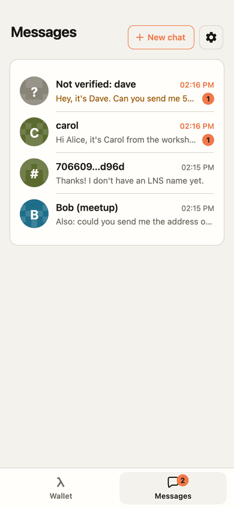
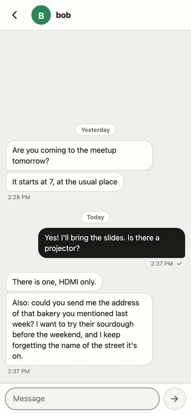
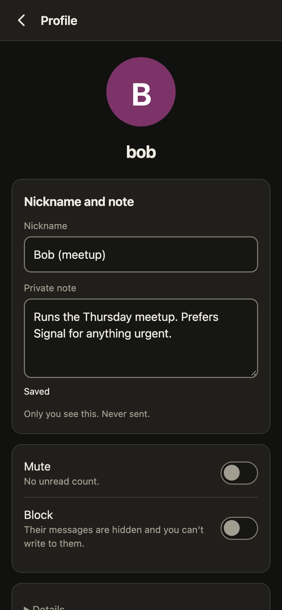

# Messages

Chats between LNS names, end to end encrypted, through a Logos Messaging node on the same device. They
exist only where such a node can run (inside the Android app, or with `WAKU_API` set). Without one, the
app and its page are exactly as before.

## Using it

- **Messages** in the bar at the bottom of the page. It locks with the wallet: the same PIN or fingerprint
  opens both, and auto-lock closes both.
- **Turn on messages** makes this phone's messaging identity. Nothing key-like is shown on the everyday
  screens. Settings (the gear) has a Messages page, the same one the gear on Messages opens. It is a short
  list: **Name** (your LNS name and whether it's linked to this phone, with the folded step that links it),
  **Address** (your messaging address: Show, with its QR code, and Copy), **Requests** (below) and
  **Blocked** (everyone you blocked, each with Unblock). Each opens its own page; Back goes to the list, then
  to where you opened it.
- The Messages screen has its own top: the title, **+** (New chat) and the gear; no node header there. Under
  the title, one small grey line only when the messaging node isn't fine: "Connecting…" or "Offline"
  (inside the Android app with a button to open the node). The Wallet / Messages bar steps aside while a
  text field has the focus, so the keyboard has the room.
- On the Wallet screen the node's state is one icon: circling arrows while it starts, re-checks, catches
  up or waits; a check when it is up to date; a stop mark when it is stopped. Tapping it opens Settings >
  Node with the full sentence and the node's numbers; inside the Android app that section also has
  **Open node**, which opens the app's own node screen.
- **New chat** (a full screen, like a chat) takes an LNS name (`alice`) or a messaging address (`msg:` and 64 hex characters, copied from
  someone's Messages settings; spaces and line breaks are ignored, `msg:` may be left out).
- A Logos Blockchain wallet address is also 64 hex characters, but it can't be messaged. The app says so
  when it is one of this wallet's own addresses or can't be a messaging address. For other bare hex it asks
  you to check, which is why a copied messaging address starts with `msg:`.
- Tap a chat's header for the person's profile: a nickname and a private note (never sent; kept encrypted on
  the phone and in the backup), mute, block (the whole row is the switch), and deleting the chat or the whole profile. The short form of
  their messaging address is under **Details**, the full one only on a further tap, and so is the safety
  code (below).

## Requests

From 0.9.22, a message from someone who isn't in your chats is a request. "In your chats" means: you have a
chat with them (you started it, or accepted them), or their profile is still kept after you deleted the chat,
or the message comes from a messaging address one of your contacts uses.

- A request shows nowhere but **Settings > Messages > Requests**. The chat list gets one line ("2 message
  requests") that opens it; there is no unread count, no badge and no preview. Its text shows only when you
  open that request, as plain text.
- Each request says plainly who it is from:
  - an LNS name (`alice`, "LNS name") only when the name service gives that name this sender's messaging
    address; if it reads like a name in your chats (`b0b` next to `bob`, or one letter off in a longer name), it
    says "not bob from your chats";
  - "Unnamed contact, No LNS name" and a short code for a messaging address without a name;
  - "Unnamed contact, Says it's alice. Not proven." when it names a name whose address is a different one
    ("Not checked yet" while the name service hasn't answered); it is never shown as alice;
  - "Unknown sender" for a message that doesn't prove where it came from.
- **Accept** makes it a normal chat (for a proven name or an address). **Delete** removes it. **Block** removes
  it and drops anything later from that messaging address unread; **Unblock** is in Settings > Messages >
  Blocked. A block wins over a chat: if you also have a chat with a blocked address, nothing is sent to it and
  its messages are hidden (kept) until you unblock it; the chat says so, with Unblock. A claimed name can't be accepted (Delete or Block it), and a message that doesn't prove its address
  can only be deleted: blocking an address it merely names would block someone else.
- **Only people I've written to** (a switch on the Requests page): messages from anyone else are deleted
  unread, including the requests waiting when you turn it on (it asks first). One exception: a message that
  names someone in your chats while the name service can't be reached waits in Requests, so a contact's new
  phone isn't lost.
- Limits, applied each time the page reads the inbox: one request per sender with its first 3 messages; 50
  requests in all (a request you opened kept first, then a proven LNS name, then an address, then an unproven
  message; within each, the oldest go first); 1 MiB of sealed messages in all; nothing older than 30 days.
- A request that names a name the name service hasn't been asked about counts like an address, except that the
  oldest 10 such requests are never dropped by the limits before their name has been asked about once. The app
  asks in the background only while the requests near the limit: at most 20 a day, the first a random 1 to 5
  minutes after it first sees them near the limit, then each a fresh random 1 to 5 minutes after the one
  before. An answer counts for a day; after that, or when you open a request whose name the name service gave
  another address for, the name is asked about again. A name proven that way is kept before addresses.
- What is dropped unread (and never shown): messages over those limits, from a blocked address, from anyone
  new while "Only people I've written to" is on, and payloads that don't open with this phone's key. Dropped
  messages are hidden at once and deleted 7 days later; within those days, the first time you start a chat with
  the sender (or accept or unblock them), their newest 3 come back, as unread; the rest stay dropped. The page counts the first four, by number only ("Deleted unread so far: 12");
  nothing about who sent them or what they said is kept.
- A message that has been sorted into a chat stays a chat message: nothing turns it into a request or drops
  it later, and the app refuses to.
- Nothing is sorted, dropped or started until your saved chats (profiles, contacts) have loaded and opened in
  this session. If they don't load, Messages says so ("Couldn't load your chats. Trying again…") and shows
  nothing. It never goes on as if you had no contacts.
- If your saved chats can't be opened with this phone's messaging address (for example after restoring a
  backup with another address), nothing is saved, not even a chat you start, until you restore the backup that
  has them or tap **Start fresh** (they are kept aside, never deleted). If the file can't be read at all,
  Messages offers **Use the last saved copy** (each save keeps the copy it replaces, written so a power cut
  can't leave it empty) or Start fresh, and a backup made meanwhile says it carries no chats.
- Blocking someone cancels what is still waiting to be sent to them. While something waits for a checked
  contact, the app reads their name on chain in the background (at most every 15 seconds) and cancels it if their
  address changed, whether or not their chat is open. Retry refuses while sending to that chat is blocked.
- The inbox and outbox files (all the chats' history) are written the same way as the saved chats: synced, with
  the copy each write replaces kept. A file that can't be read is kept aside, never written over, and the last
  copy is used.
- Apart from those background asks, the app looks up a name a request claims when you open Requests (one at a time, stopping
  when you leave), so a stranger's message doesn't make the phone ask the name service (or do the work a
  lookup takes) on its own.
- What the page does on its own (reading and sorting the inbox, the lookups and saves that follow) doesn't
  count as you using the app, so messages arriving can't keep the wallet from locking.
- Messages that arrived before 0.9.22 keep the earlier rule: they started a chat.

## QR codes

- Receive (in the wallet) shows your wallet address as a QR code: the 64 hex characters, nothing added.
  Settings > Messages shows your messaging address as one (`msg:` and the 64 hex characters) when you tap
  Show. Codes are drawn in the page by a vendored encoder (app/qr), with no network requests. No amounts are
  in them.
- Inside the Android app, Send and New chat have **Scan**, which opens the phone's camera
  (`window.LogosAndroid.scanQr()`; the app answers `window.logosScanned(text)`, or `window.logosScanFailed(msg)`,
  with no message for a cancel).
  The camera permission is asked the first time Scan is tapped. A scan only fills the box it was started
  from, and only with the kind of address that box takes; it never sends anything. A messaging address
  scanned in Send, or a wallet address scanned in New chat, is not filled in: a message says what it is.
  Codes the app reads: 64 hex characters (a wallet address) and `msg:` plus 64 hex characters (a messaging
  address); anything else is refused. In a plain browser there is no Scan: type or paste the address.

## Names, addresses and trust

- A name's messaging address is its `msg` text entry on the chain. The first time you talk with a name, the
  app pins the address it has then. If the entry changes later, the chat shows "alice's messaging address
  changed" and sends nothing to the new address until you accept it. Messages from the earlier address stay
  marked as such.
- Unless you compare codes, the first address is whatever the name service gave, and the app trusts it.
- **Safety code** (from 0.9.22; in the profile's Details): 60 digits in 12 groups of 5, made from your
  messaging address and theirs. Both phones show the same code. Compare it with them (in person, or over a
  channel you trust) and tap **The codes match**; inside the Android app, **Scan their code** reads the QR
  code their phone shows under **Show my code**. Only a match marks the contact "Checked in person", shown in
  Details and nowhere else. Scanning the QR of their messaging address only says whether it matches the one you
  have: that checks one way, so it marks nothing. **Mark as not checked** takes it back.
- When a checked contact's address changes, nothing is sent until you compare codes again (the code shown is
  then the new address's) or tap **Accept without checking**, which asks first and ends "checked". An
  unchecked contact keeps the plain "address changed" step above.
- How the code is made: for each of the two messaging addresses (32 bytes), SHA-512 of the text
  `names/safety-code/v1` followed by the address, then 5,200 more rounds of SHA-512 of (the last result
  followed by the address); the first 30 bytes give 6 groups of 5 digits (each 5 bytes as a big-endian number,
  modulo 100,000). The two 30-digit halves, sorted, make the code. The names are not in it: the two phones may
  not show the same name for each other, and the code is about the addresses. The QR code holds
  `names-safety:1:` and the 60 digits. `tests/msg_v2_test.mjs` checks it against a separate Python version.
- A message is shown as from a name only if it proves it was sent with that name's pinned address.
  Anything else is marked "Not verified". When all is fine the screens say nothing about it: only problems
  show ("Not verified", "Address changed", "Messages off"). Pinning at first contact is trust on first use,
  not a check of who someone is, so the app never shows "verified" as a badge.
- Someone without an LNS name can still write and be written to, by messaging address. New chat asks what
  to call them; without a nickname the chat is "Unnamed contact" (never hex), and its header says "No LNS
  name". The short code (`1a2b3c…7d8e`) is on the profile only.
  If you later look up a name whose `msg` entry is that address, the app offers to merge the two chats.

## Message sizes

From 0.9.22 every message is padded before it is sealed, so the network sees one of four sizes, not the
length of what you wrote: the sealed text (the JSON inside the encryption) is exactly 512, 2,048, 8,192 or
15,872 bytes, which is 585, 2,121, 8,265 or 15,945 bytes on the wire. A short message goes from about 475 to
585 bytes. The padding is a field `"p"` of spaces next to the format's own fields; readers of the version 1
format (the Names web app included) take only the fields they know, so they open these messages as before.
The field is inside the encryption and outside the sender's proof. The largest text the format allows (2,000
characters, at worst 6 bytes each once escaped) fits the top size. Copies kept on the phone are not padded.

## Sending without a name

The Names message format (version 1) needs a name-shaped `from`. A sender with no name puts
`msg-` followed by the first 16 hex characters of its own messaging address there. The message also carries
the full address and proves the sender holds it, so a receiver that sees exactly that pairing treats the
sender as an address, and nobody else can write as it. The wire format is unchanged: the Names web app opens
such a message and shows it as "unverified: claims to be msg-1a2b…" (it can't reply to it, since that isn't a
registered name). Messages between two names are byte for byte the Names format.

## What is kept, and where

Everything stays in the app's data folder on the phone:

| file | what |
|---|---|
| `wallet-msgkey.json` | the messaging identity: an Ed25519 seed and the X25519 key pair made from it (see docs/backup.md) |
| `wallet-inbox.json` | incoming messages exactly as they came off the network: sealed to the messaging key; once the page has opened one, marked as a chat message or a request (nothing else about it) |
| `wallet-outbox.json` | sent messages: a copy encrypted by the page, and the sealed payload for each recipient until the network has it |
| `wallet-chat.json` | profiles, nicknames, notes, conversations, which contacts you checked (and for which address), blocked addresses, the Requests switch and its counts: one blob encrypted by the page |

The page encrypts its copies and the profiles with XChaCha20-Poly1305 under a key made from the messaging
secret (HKDF-SHA256, info `logos-node/chat/v1/store`). The app's server code only stores and returns these
blobs and never decrypts them, and it hands them only to an unlocked page. The messaging key is stored on the
phone like the node's own keys, so the chats are unreadable without it, but no safer at rest than that key
file.

The app's event log records "message sent" and nothing about the message, the person or the count.

## Delivery

The app sends through its own queue: one post to the messaging node at a time, a second apart, and it follows
each one. Under your message a clock means it's waiting or on its way, one tick means the network has it, and
**Not sent** comes with **Retry**. The network holds a sent message so the other person gets it the next time
they're online; the app can't tell when they read it. A message written while you're offline waits and goes
when you're back. Message details (tap a message) show the state for each recipient.

## Limits

- The unread count that the Android app can show (`messaging_inbox_count()`) counts incoming messages the
  page hasn't shown yet. The app can't open messages itself, so it can't tell a request, or a muted or
  blocked person's message, from any other until the page has been open once after it came (the page then
  marks requests read, and deletes what it drops).
- Until then, messages wait sealed and unsorted, in room for 2,000 of them (8 MiB) besides your chats'
  messages. When that is full, the newest still gets in and the oldest waiting one goes: first a request you
  haven't opened (and that isn't a proven name), then an unsorted message, and last a request you opened or a
  proven name's. Messages then says "Up to N messages may have been lost…", counting only what could have been
  a message, once per burst and at most once a day. The app can't fetch a lost one again: the messaging
  node has no way to ask the network's store for it (it only catches up around its own start). What a flood
  can still do while the page is away: the messaging node passes at most 50 messages per 3-second read, so
  about 2 minutes of small junk, or about 30 seconds of the largest size, push out a message that came before
  the flood. A message that arrives after the flood always gets in. Your chats' own history is capped apart
  (2,000 messages), so a flood from strangers can't push it out.
- The tick under a sent message means the network took it, not that the other phone kept or read it.
- Requests protect the screen, not the battery or the data: everything sent to your address still reaches
  the phone.
- The messaging node keeps at most 50 received messages between two reads by the app (every 3 seconds); more
  in between are dropped and shown as missed.
- History in a backup is capped at 1 MB, newest first.
- Groups are not in this version.

## Screens

Taken by `tests/chat_ui.mjs` (headless Chrome at phone width; `SHOTS=<folder>` saves them), light and dark
in `img/messages/`: `locked`, `locked-android`, `home-no-name`, `my-messaging-address`, `link-your-name`, `new-chat-by-name`,
`new-chat-by-address`, `list`, `chat`, `chat-address`, `profile`, `profile-address`, `key-changed`,
`message-details`, `locked-wrong-pin`, `locked-android-cancelled`, `locked-android-keypad`,
`wallet-home-big-balance`, `wallet-home-hidden`, `turn-on`, `empty-list`, `messages-home`, `wallet-home`, `wallet-home-starting`,
`wallet-receive`, `wallet-send`, `settings` (the list of groups), `settings-node`, `settings-messages`,
`settings-security`, `settings-updates`, `settings-backup`, `settings-restore`, `settings-about`,
`list-with-requests`, `requests`, `request`, `request-claim`, `blocked`, `safety-code`, `profile-checked`,
`key-changed-checked`, `safety-code-scanned`, `chats-not-loaded`, `chats-file-unreadable`, and `requests-large-text`, `a-request-large-text`, `blocked-large-text`, `the-safety-code-large-text` (text at 130%),
`settings-android` (Settings > Node with the Android bridge), and `wallet-header-sync` / `wallet-header-ok` (the page's
status words set by hand, to show the icons; the test has no running node).

  
